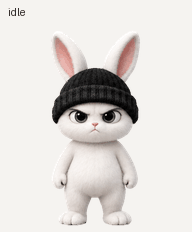

# Beanie Bunny — Codex Pet

검은 비니를 쓴 새하얀 토끼를 위한 ChatGPT Work 커스텀 펫 파일입니다.

[동작 미리보기와 다운로드 안내 사이트](https://beanie-bunny-pet.orange-cat-ai.chatgpt.site/)

## 받기

- [펫 PNG](beanie-bunny-v2.png): 최종 v2 투명 스프라이트 시트 (1536 × 2288px, 필수 73프레임)
- [제작 프로젝트 ZIP](beanie-bunny-project.zip): 원본 이미지, 지시문, 미리보기, QA 결과와 전체 제작 기록

GitHub 파일 페이지에서 **Download raw file**을 선택해 저장하세요. ChatGPT Work에서 커스텀 펫 업로드 기능을 사용할 수 있다면 `beanie-bunny-v2.png`를 등록할 수 있습니다.

## 검증 및 배포 상태

최종 PNG는 v2 형식 검사, 동작 품질 검사, 방향 숨김 검사를 통과했습니다. 자세한 결과는 프로젝트 ZIP의 `qa/`에 있습니다. GitHub에서 파일을 내려받을 수 있는 것과 다른 계정에서 펫으로 등록할 수 있는 것은 별개입니다.

ChatGPT가 발급한 펫 공유 페이지는 실제 클릭 시 **“이 대화에 접근할 권한이 없습니다”** 오류가 확인되어 설치 경로로 안내하지 않습니다.

## 사용권

이미지와 GIF는 [CC BY-NC 4.0](LICENSE-ART.md)으로 공유합니다. 출처를 표시한 비상업적 재사용과 수정이 가능합니다.
